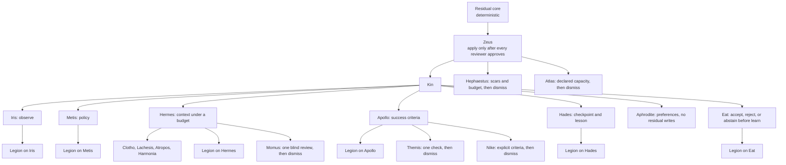

# Resileos-QAI

Resileos-QAI stores facts and answers from those facts. The deterministic residual core compresses and steps a matrix. Titanos, in `scripts/titanos.py`, is the exact-memory engine on top of that core. The harness decides what may be written and what may be said. Kin, Demi-gods, and legions are roles around that core. They do not replace it.

Version `1.0.0`. Python `>= 3.11`. License Apache-2.0.

## How the gods are structured

Zeus applies a write only after every reviewer approves. Kin are standing roles. A Demi-god is summoned, runs one deterministic check, and is dismissed. A legion is one bounded tool registered on one Kin.



The mouth is a prose peripheral. It is not a god and it does not own the record. Persona files are markdown. The decisions are ordinary functions (`docs/320-titanos/demigods.md`).

## Titanos

`Titanos.ask(subject, relation, as_of=None)` returns one `Answer`. `ask_list` returns every object in the queried slot. `chain(start, relations, as_of=None)` walks `ask` once per hop and keeps the path.

| Status | When |
|---|---|
| `ACCEPTED` | The value is a stored fact that survived the gate. A finished chain is `ACCEPTED` only when every hop was. |
| `ABSTAINED` | The store does not support an answer. A chain that breaks on a hop that is not `CONFLICT` returns `ABSTAINED`. |
| `CONFLICT` | Two or more explicitly bounded facts for the same subject and relation are both valid at `as_of` and name different objects. `ask` returns `value=None`. `ask_list` still returns every value. A chain that hits `CONFLICT` returns `CONFLICT`. |

Unbounded multi-valued relations such as `parent_of` are not treated as conflicts. The API also returns `NO_ROWS` and `NONE_CHANNEL` on some routes. `CANDIDATE` is not a query status.

`docs/320-titanos/temporal.md` still says status `draft`. The behavior above is what `scripts/titanos.py` and `tests/test_titanos.py` / `tests/test_review_fixes.py` implement.

## Temporal overlay

Facts may carry `valid_from` and `valid_to`. The interval is half-open: `[valid_from, valid_to)`. `None` on `valid_from` means unbounded at the start. `None` on `valid_to` means still open. `learn()` without those arguments stores `(None, None)`.

`as_of` selects which facts count:

- `None` — current state, when `temporal_filter_current` is on
- an ISO 8601 date — only facts valid at that moment
- `""` — every fact, validity ignored

Tests cover the Athens `capital_of` windows: `as_of="1800-01-01"` is `Ottoman Empire`, `as_of="1900-01-01"` is `Greece`, and `ask` at `1860-01-01` on two overlapping windows returns `CONFLICT` with `value=None` while `ask_list` returns both objects. `chain(..., as_of=...)` forwards `as_of` on every hop. SPARQL accepts `AS OF`.

`scripts/run_temporal_probe.py` on this tree, against `configs/titanos-facts.json`, reports reference M9 `0.0000` (`0/141`) and synthetic overlap `2/2` with non-overlap singular `2/2`. `docs/400-operations/capacity-results.md` still lists M9 as deferred from the 2026-11-03 acceptance run. That sentence in the capacity note is behind the probe.

## Harness

`ControlPacket` (`src/resileos/harness/packet.py`) is the record between the residual core and tools. Fields include `confidence`, `risk_class` (`allow`, `ask`, or `deny`), `verified`, loaded guides and their text, `budget_remaining`, `evidence`, `scars`, and a short `history`.

`SeparatedCycle` (`src/resileos/harness/separated.py`) splits write, review, and apply. A writer receives a capture shim, not `learn`. Reviewers return a verdict. Zeus calls the real learn function only when every reviewer approves. Wired reviewers include the deterministic verifier swarm, `council_query` (hub `CONFLICT`), and the optional Athena frame gate.

Mouth policy (`src/resileos/kin/mouth_policy.py`): `should_render_prose` returns true only when the client asked for prose, Metis allows it, and, with `require_verified=True` (the default), the cycle harness reports `verified`. An unverified cycle does not authorize prose. Metis defaults `allow_mouth` to false (`src/resileos/kin/metis.py`).

## Kin

| Kin | Role in code |
|---|---|
| Iris | Observes metrics and flags. Does not answer user facts. |
| Metis | Turns an Iris report into policy: mouth flag, Hermes depth, child enable and disable lists. Does not learn world triples. |
| Hermes | Ranks and truncates context the caller already supplied, under `max_depth` and `max_items`. Does not invent context. Clotho, Lachesis, Atropos, and Harmonia sit under Hermes. |
| Apollo | Golden-ladder hops, success criteria, and `verify_on_stop`. Art paths are not required to be pure truth. |
| Hades | Checkpoints and lessons. The lesson crosses attempts. Full history, full evidence, and scars stay inside the attempt. `save()` does not itself require `verified`. |
| Aphrodite | Preferences, care weights, and a persona that grows on verified tutorial steps. Does not write residual facts. Legions: Calliope, Ligeia, Echo. |
| Eat | External text becomes accept, reject, or abstain. Only an accepted triple may be learned. |

`KinBundle.cycle` runs Iris then Metis. Routes live at `/api/v1/kin/*` and `/api/v1/eat/*` via `wire_kin` in `app.py`. `/api/v1/world/*` and `/api/v1/guild/*` exist in `src/resileos/answer/api_routes.py` and are not registered on `app.py`.

## Demi-gods

Themis, Momus, Hephaestus, Nike, and Atlas are summoned skills under Kin (`docs/320-titanos/demigods.md`, RES-343). Each call loads one persona file, capped at `GUIDE_BODY_CAP`, runs one check, and `demigod_dismiss` removes that guide id. They cannot call `learn`, own the residual core, or summon each other.

| Demi-god | Check | Pass |
|---|---|---|
| Themis | `themis_check` | Residual consistency, Apollo success, and a Hades lesson with `verified=true` all agree. Missing evidence fails. |
| Momus | `momus_review` | Every explicit requirement holds, and a supplied residual hash is 64 lowercase hex characters. Missing requirement, hash, or spec field is `need_more`, which is not approval. History and author notes are stripped before the review. |
| Hephaestus | `hephaestus_check` | Residual consistency passes, scars are empty, and the budget guard passes. A supplied Hermes budget must stay at or under `max_items`. |
| Nike | `nike_check` | Every explicit criterion holds, backed by Apollo success or residual consistency. No criteria means fail. |
| Atlas | `atlas_check` | Each declared load sits inside the real capacity function for that load (`check_capacity` / `hopfield_cap`, `MaskStackConfig` / `PrimeTower.n_usable`, `PrimeTower.max_usable_level`, `n_usable_primorials`, `default_capacity`, `EVIDENCE_CAP`). An undeclared load is not invented. |

## Legions

Legions are beta. `register_legion` (`src/resileos/kin/legions.py`, RES-345) attaches one tool to one Kin. The tool inherits that Kin's `risk_classify` gate, `evidence_attach`, and budget check. Callers reach it only through that Kin's catalogue. There is no global registry.

A legion cannot take the residual core, bypass Zeus routing, cross the Hades checkpoint boundary, or turn the verified-cycle mouth on. `perception` is an alias of `eat`. `register_example_legions` registers nothing unless `enable=True`. The examples do not open a socket.

## Studio

The Studio residual codec is experimental. It encodes a matrix you already have and decodes that packet. A round trip does not call `learn` and does not update the scar matrix. Sampled images are candidates, not facts (`src/resileos/studio/panel.py`). `learned_conv` is registered and untrained.

On `sklearn.datasets.load_digits` (1,797 images, 8×8, values divided by 16), stratified holdout seed 0, the best layer-scale codec in `docs/studio/research.md` is PCA ±1, rank 1, 2 layers: **10.84 dB** PSNR (`psnr_from_mean_mse`), global SSIM **0.613**, **96** bits. That study is CPU digits, not photographs or video. The run recorded there took 11.75 seconds (NumPy 2.5.4, scikit-learn 1.9.1).

External samplers are off by default. `RESILEOS_EXTERNAL_SAMPLER` unset, `off`, `none`, or `disabled` leaves the sampler off. `fake` builds a deterministic ±1 packet in process. Any other name stays off, including `p-h3-image`.

### MiniMax-H3-Image license

`minimax_api` is a stub for the hosted MiniMax-H3-Image API. It stays off unless that name is set and `MINIMAX_API_KEY` is set. A key alone sends nothing. The stub asks for `b64_json`, re-encodes the pixels with the residual codec, and returns only the packet. This repository does not vendor the weights.

MiniMax-H3-Image, MiniMax-H3 (video), and Pruna P-H3-Image are three different models. The image card releases the checkpoint under the MiniMax-H3-Image Community License (license date November 10, 2026), which also covers MiniMax-H3-Image-PE. Excluded territories named in that license are the European Union, the United Kingdom, the Republic of Korea, and the United States of America. The grant applies only outside that list. The license text says use of the works or their outputs outside the Applicable Territory is not authorized. A separate license is requested at [platform.minimax.io/license](https://platform.minimax.io/license). Section IV of the same license requires separate written authorization if annualized revenue of you and your affiliates exceeds 1 million USD, or if you provide a hosted service to third parties. Full notes: [docs/studio/external-samplers.md](docs/studio/external-samplers.md).

## Benches

Numbers below are the runs written into `docs/benchmarks/` on 2026-11-10. No model key was set for those runs. Cost per 1,000 queries was not measured.

| Bench | Result | Reproduce |
|---|---|---|
| Exact memory | Exact-match **1.0** on 3 known facts. Invent rate **0.0** on 12 unknown pairs. p50 **35.093815 ms**, mean **35.693131 ms**, on the 3 known queries. Backend field `titanos`. | `PYTHONPATH=src python scripts/ops/bench_vs_llm.py` |
| Chain composition | **1.0 (3/3)**, all `ACCEPTED`, via `/chain`. Grandchild 85.4 ms, grandparent 91.8 ms, parent's workplace 45.7 ms. `RESILEOS_AUTH_BYPASS=1` against `http://127.0.0.1:8000/api/v1`. | `python scripts/ops/bench_compositional.py` |
| Invention | `derivation_rate` **0.0**, `invention_assertion_rate` **0.0**, `p50_ms` **3.4**. The two invention probes returned `ABSTAINED`. | `python scripts/ops/bench_invention.py` |
| Equal budget | 22 tasks, budget 8. Residual/Apollo and Kin+Demi-gods+Hades both **22/22**, correct-abstain **6/6**, false accepts **0**. Mean steps 1.0 vs 6.0. Mean latency 0.361 ms vs 43.230 ms. | `PYTHONPATH=src:scripts python scripts/bench/equal_budget.py` |
| Temporal probe | Reference M9 **0/141**. Synthetic overlap **2/2**, non-overlap singular **2/2**. | `PYTHONPATH=src:. python scripts/run_temporal_probe.py` |
| Capacity M1–M4 | 2026-11-03 acceptance on the 120-fact corpus: M1 **1.0**, M2 **0.0**, M3 **1.0**, M4 **1.0**. M5–M8 are still deferred in that note. | [docs/400-operations/capacity-results.md](docs/400-operations/capacity-results.md) |

## Install and tests

```bash
pip install -e '.[dev]'
pytest -q
```

`[dev]` installs pytest, jsonschema, httpx, FastAPI, uvicorn, scikit-learn, and Pillow, on top of the runtime dependencies (NumPy, torch, requests). Streamlit is the `[ui]` extra. `[all]` is `[dev,ui]`.

The recorded full suite on `ee9199ad` is **1252 passed** (`landing/CAPABILITIES.md`).

## Run

```bash
uvicorn asgi:app --port 8000 --reload
```

`asgi:app` installs `middleware/auth.py`. `app:app` fails closed unless `RESILEOS_AUTH_BYPASS=1`. Use that bypass only on a local machine. Hosting, the tunnel, and the key file are in [HOSTING.md](HOSTING.md). The public marketing site is [https://resileosai.fun](https://resileosai.fun); see [landing/README.md](landing/README.md).

## Roadmap

These items are **PLANNED**. None of them are in the tree.

- A plan/test/debug loop on the Hermes / `SeparatedCycle` path, before Apollo or Hades mark the cycle verified.
- A graphify ingest legion under Iris and Eat. It would turn external documents into residual triples through the eat/learn path.
- A Forge video legion wrapping the Higgsfield CLI/MCP or the Seedance API. The path would be draft, then verify, then upscale, behind `risk_classify`.
- Optional legions, each gated: browser-use, an impeccable design audit, and Google Workspace.

The candidate status on the query path is also unbuilt. The quantum backend in `docs/500-notes/roadmap.md` stays speculative.

## Documentation

- [docs/readme.md](docs/readme.md) — index
- [docs/320-titanos/demigods.md](docs/320-titanos/demigods.md) — RES-343
- [docs/320-titanos/legions.md](docs/320-titanos/legions.md) — RES-345
- [docs/320-titanos/temporal.md](docs/320-titanos/temporal.md) — RES-332
- [docs/studio/research.md](docs/studio/research.md) — STUDIO-001
- [docs/studio/external-samplers.md](docs/studio/external-samplers.md) — STUDIO-002
- [docs/benchmarks/equal_budget.md](docs/benchmarks/equal_budget.md) — RES-344
- [docs/marketing/pricing.md](docs/marketing/pricing.md) — what may be sold
- [changelog.md](changelog.md)
