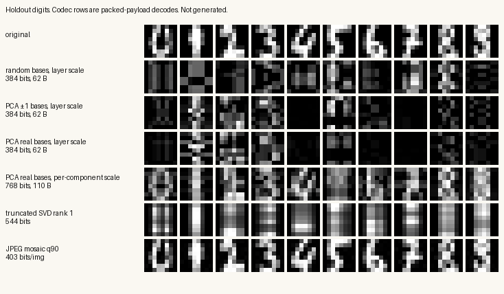
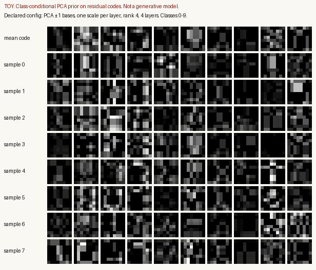
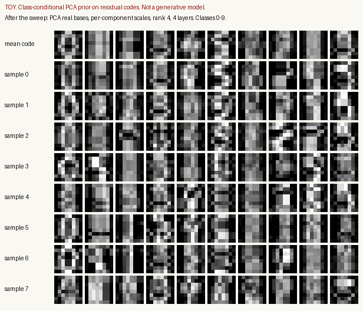

# What a studio would take

`ResidualCore` compresses a matrix you already have. It does not sample
pixels, and it does not read a prompt. A studio — stills, and only later
video — needs a learned prior that proposes codes, a decoder that turns
those codes into pixels, and a packet that can actually be decoded. The
core stays the quantizer. It does not become the thing that invents.

This note is a design, plus one measurement. Every digit-image number
below is from `scripts/studio/measure.py` in this branch, written to
`scripts/studio/outputs/metrics.json`. The run took 11.75 seconds on CPU
(NumPy 2.5.4, scikit-learn 1.9.1). It is not a result about photographs,
ImageNet, or video. Quoting these PSNR figures as if they were is the
failure mode this repo is built to avoid.

CIFAR-10 was not downloaded. The measured set is `sklearn.datasets.load_digits`:
1,797 images, 8×8, ten classes, values divided by 16 so they sit in
[0, 1]. Stratified holdout, seed 0, 36 images per class: 1,437 train,
360 test. Bases that claim to be learned were fit on the train split only.

PSNR below is `psnr_from_mean_mse`: `10 log10(1 / mean squared error)`
on the holdout, peak 1. The file also stores the mean of per-image
PSNRs. Do not quote that one. It goes to 291 dB and 308 dB for SVD ranks
6–8, where some images are exact and the mean of the ratios explodes.
Global SSIM here is one window, the whole 8×8 image, with N−1 variances
and L = 1 (the Wang et al. formula). It is not the mean of 11×11 local
windows that papers report as SSIM. An 8×8 image cannot host that window.

## What the engine does

For a matrix `W` and a fixed pair of bases `Ub0` (m × r) and `Vb0` (r × n),
each layer of `_factorize_residual_stack` does four things:

1. Project the residual: `U = R @ Vb0.T`, `V = Ub0.T @ R`.
2. Keep the signs. Those are the bipolar factors `Ub`, `Vb`.
3. Fit one scale, `s = <R, Ub @ Vb> / <Ub @ Vb, Ub @ Vb>`.
4. Subtract `s * Ub @ Vb` and repeat.

The bases in the engine today are random ±1 draws, frozen at init
(`src/resileos/core.py`). The sum of the layers is `last_reconstruction`.
One scale multiplies the whole rank-r product. There is no per-component
gain. The scar update, the volume guard, and the prime-tower schedule do
not enter the reconstruction. RES-401 keeps them free of gradients.

The RES-201 control packet stores layer 0's `Ub` and `Vb` only. It does
not store `s`, and it does not store later layers. On the first 32
holdout digits, with rank 4, 4 layers, and the random bases, the product
`Ub @ Vb` from that packet has mean squared error 6.01 against the
image. The studio packet, which stores every layer's factors and scale,
decodes to the engine reconstruction with mean squared error 6.24×10⁻¹⁷.
That gap is the bug the reviews pointed at. The studio packet does not
replace RES-201. The harness notes say the control-packet schema stays
put. `studio-codec/1` is a side packet for pixels.

`decode` reads the packet and nothing else. The bases are an encoder-side
dictionary. A shared dictionary is not counted in the per-image bit
budget below. For these 8×8 images a bipolar basis of rank r is `16 r`
bits once. A real PCA basis, stored as float32, is `512 r` bits once.
Spread over 360 test images that is a few bits per image. It does not
change the comparison.

`local_gen` is not this codec. It tints a random field with three
oscillator phases. `video_gen.request_video` returns `not_configured`
unless `RESILEOS_VIDEO_PROVIDER` is set. Neither is a sampler in the
residual code space.

## How the stack relates to known methods

The stack is a greedy residual factorization with a bipolar constraint
and a single gain per layer. Several published lines share a piece of
that and none of them is this algorithm.

**Truncated SVD.** Eckart and Young (Psychometrika, 1936,
[doi:10.1007/BF02288367](https://doi.org/10.1007/BF02288367)) and the
later Mirsky form say that the best rank-k approximation of a matrix in
the Frobenius norm is the truncated SVD. One layer of this engine is not
that approximation. The factors are ±1, the bases are not the singular
vectors, and one scalar multiplies the whole product `Ub @ Vb` instead of
a singular value per component. On the holdout, SVD rank 1 (float32 `U`,
`s`, `Vt`: 544 bits) reaches 13.26 dB. The engine's own rule at its best
measured layer-scale point, rank 1 and 8 layers (384 bits), reaches 8.98 dB
with random bases and 11.39 dB with real PCA bases. SVD rank 2 is 17.64 dB
at 1,088 bits. SVD rank 4 is 29.22 dB at 2,176 bits. Ranks 7 and 8 are
numerical roundoff on an 8×8 matrix (mean squared error about 10⁻³¹) and
are not a quality claim.

**Greedy residual approximation.** Subtracting a scaled atom and repeating
is the shape of matching pursuit (Mallat and Zhang, IEEE Trans. Signal
Processing, 1993,
[doi:10.1109/78.258082](https://doi.org/10.1109/78.258082)). The difference
is the dictionary. Matching pursuit picks from an explicit list. Here the
"atom" is whatever bipolar matrix the sign of the projection produces.
The search is one shot per layer, not a sweep of a codebook.

**Vector quantization and residual vector quantization.** A VQ codebook
replaces a vector by the nearest of K stored vectors. Residual (multistage)
VQ quantizes the leftover with a second codebook, then a third. SoundStream
(Zeghidour et al., 2021, [arXiv:2107.03312](https://arxiv.org/abs/2107.03312))
and EnCodec (Défossez et al., 2022,
[arXiv:2210.13438](https://arxiv.org/abs/2210.13438)) train that cascade
jointly with a neural encoder and decoder. VQ-VAE (van den Oord, Vinyals,
and Kavukcuoglu, 2017, [arXiv:1711.00937](https://arxiv.org/abs/1711.00937))
puts a codebook between an encoder and a decoder and trains a prior on the
indices. RQ-VAE (Lee et al., 2022, [arXiv:2203.01941](https://arxiv.org/abs/2203.01941))
stacks several codebooks on the same feature vector so a 256×256 image can
be an 8×8×4 grid of codes, then an autoregressive transformer predicts the
next stack.

The residual core is in that family only at the level of "quantize, subtract,
repeat." It has no learned codebook of K vectors. A layer's code is the
bipolar matrices themselves: `m r + r n` bits, plus the scale. For 8×8 and
rank 4 that is 64 bits of signs plus 32 bits of scale, and the encoder
never searches a codebook. The nearest published role for it is the
quantizer slot inside VQ-VAE or RQ-VAE, not the whole autoencoder and not
the prior.

**Latent diffusion.** Ho et al. (2020, [arXiv:2006.11239](https://arxiv.org/abs/2006.11239))
learn to denoise. Rombach et al. (2022,
[arXiv:2112.10752](https://arxiv.org/abs/2112.10752)) run that denoiser in
the latent of a pretrained autoencoder and add cross-attention for text.
The autoencoder is the codec. The diffusion model is the prior. Nothing
in `ResidualCore` is a denoiser, and nothing in it is conditioned on text.

**Flow matching.** Lipman et al. (2022, [arXiv:2210.02747](https://arxiv.org/abs/2210.02747))
regress a velocity field along a path from noise to data. Rectified flow
(Liu, Gong, and Liu, 2022, [arXiv:2209.03003](https://arxiv.org/abs/2209.03003))
is a straight-path cousin. Movie Gen (Polyak et al., 2024,
[arXiv:2410.13720](https://arxiv.org/abs/2410.13720)) uses flow matching
for joint image and video generation. A flow model can sit on the same
latent a residual quantizer produces. The flow model is not the quantizer.

**Autoregressive token models.** VQGAN (Esser, Rombach, and Ommer, 2021,
[arXiv:2012.09841](https://arxiv.org/abs/2012.09841)) trains a transformer
on codebook indices. MaskGIT (Chang et al., 2022,
[arXiv:2202.04200](https://arxiv.org/abs/2202.04200)) predicts masked
tokens in parallel. Parti (Yu et al., 2022,
[arXiv:2206.10789](https://arxiv.org/abs/2206.10789)) predicts image
tokens conditioned on text tokens. RQ-Transformer is the residual-code
version: the codes are a depth stack, and the model predicts the next
spatial position's stack. That is the prior you would train if the studio
packet's bipolar factors were the tokens. This repo has not trained one.

**Video tokenizers, for later.** MAGVIT (Yu et al., 2022,
[arXiv:2212.05199](https://arxiv.org/abs/2212.05199)) quantizes a clip with
a 3D VQ autoencoder and trains a masked transformer. Stable Video
Diffusion (Blattmann et al., 2023,
[arXiv:2311.15127](https://arxiv.org/abs/2311.15127)) starts from an image
latent-diffusion model, inserts temporal layers, and finetunes on video.
Their paper describes a Large Video Dataset of 580M annotated clips,
filtered to 152M (LVD-F). One training setting they publish for the
models in that study is 12k steps, about 16 hours, on 8 A100 80 GB GPUs.
That figure is that setting, not a full accounting of every stage. Movie
Gen reports infrastructure of up to 6,144 H100 GPUs. Those are the scales
at which a video prior is a real project. They are not a plan for this
codebase's next patch.

## Three architectures

All three keep the residual stack as a quantizer. All three add the same
missing parts. They differ in where the pixels come from and what the
prior is.

Parts that are not in the engine today:

| Part | Today | What a studio adds |
|---|---|---|
| Bases | Random ±1, fixed | Fit or learned. PCA was measured below. A conv encoder is the real version and was not trained. |
| Scales | Computed, then dropped by RES-201 | Stored. One per layer is the engine. One per component is a variant, measured, not in the engine. |
| Decoder | The sum `Σ s Ub Vb` | That sum is the baseline. A conv decoder, trained, is the upgrade. Not trained here. |
| Loss | None. The core is deterministic. | Pixel L1 or MSE against the original, plus a commitment term so the encoder output stays near the quantized sum. Perceptual and adversarial losses only after the MSE is honest. |
| Sampler | None | A prior over codes or over the pre-quantization latent. The toy below is a class-conditional PCA. It is not a sampler you would ship. |
| Text | None | Cross-attention in a diffusion or flow prior (LDM), or prefix tokens in an autoregressive prior (RQ-Transformer, Parti). The text encoder is a separate model. |
| Time | Per-frame stack, no motion model | 3D patches or temporal layers in the prior. After stills pass a gate. |

The core's scar update stays frozen. If an encoder is trained, gradients
stop at the quantizer (straight-through on the signs, the same idea as
VQ-VAE's straight-through on the codebook). They do not enter `Λ`.

### 1. Pixel tokenizer, autoregressive prior

Use the studio packet as the tokens. Learn the bases. Store the scales.
Optionally train a small conv net to map the linear sum back to pixels.
Train a transformer on the bipolar codes, conditioned on a class id or on
text tokens.

This is the smallest step from the code that exists. The digits run is
evidence against shipping it as a pixel codec. With one scale per layer,
raising the rank makes the picture worse, not better: the best layer-scale
points are rank 1. At 384 bits, rank 4 with 4 layers and PCA ±1 bases is
7.33 dB (global SSIM 0.156). Rank 1 with 8 layers and the same bases is
11.38 dB (global SSIM 0.662). A single gain cannot steer r bipolar
components, so extra components mostly add a pattern the scale then has
to average. Per-component scales, which the engine does not compute, are
the fix inside this family: PCA real bases, rank 4, 4 layers, 768 bits,
13.88 dB, global SSIM 0.832. The best measured point in that family is
rank 8, 8 layers, 3,072 bits, 20.88 dB. JPEG's mosaic at quality 30 is
21.20 dB at 166.2 bits per image. The linear sum is not competitive on this
set, even after the scale fix and learned bases.

### 2. Latent quantizer, learned decoder, flow or diffusion prior

This is the architecture to build if stage 1 below passes.

A conv encoder maps the image to a small feature map. The residual stack
quantizes that map the way RQ-VAE's residual quantizer quantizes a
feature, or the way SoundStream's residual vector quantizer quantizes an
encoder frame. A conv decoder maps the quantized map to pixels. The
training loss is pixel reconstruction plus commitment. The linear sum is
the decoder's input, not the displayed image.

The prior is a separate network on the continuous latent (flow matching
or latent diffusion) or on the discrete codes (an RQ-Transformer). Text,
if it is added, enters the prior. The quantizer does not see the prompt.
Sampling draws a latent or a stack of codes, the decoder renders pixels,
and the result is marked as a candidate. It is not written as a record of
the world.

Why this and not architecture 1: the measurement says the bipolar sum is
a weak pixel model, and a prior cannot put back structure the quantizer
destroyed. On the predeclared config (PCA ±1 bases, one scale per layer,
rank 4, 4 layers) the holdout reconstruction is 7.33 dB. A class-conditional
PCA prior on those codes has a same-class nearest-training-image rate of
0.05, which is worse than the 0.10 a guess among ten classes would score,
and 0 exact copies of a training image. The samples look like noise
because the codes do not preserve the digit. On the component-scale codec
at 13.88 dB the same toy prior reaches a same-class rate of 0.4125, still
with 0 exact copies. Better codes, slightly less hopeless samples. That
is the entire argument for a learned decoder: move the reconstruction job
off the bipolar sum. It is an argument, not a measured gain. No decoder
was trained.

### 3. Video, after the stills gate

Do not start here. A video model is architecture 2 with time added, in
one of the published ways: a 3D tokenizer and a masked transformer
(MAGVIT), temporal layers on an image latent model (Stable Video
Diffusion), or flow matching on a joint image/video latent (Movie Gen).
Frame-wise studio packets with no temporal prior will flicker, and the
current `request_video` path is an external provider for that reason.

`local_gen` stays what it is: a patterned random field. Calling it a
video model would be false.

## What the digits run measured

Reproduce with `python3 scripts/studio/measure.py`. The script adds `src`
and `scripts` to its path. Quality for the codec is computed from
`unpack(pack(packet))`, so the scales in the scored reconstruction are
the float32 values in the payload, not a wider in-memory float.

Per-image logical bits for the studio codec are `layers * (m r + r n + 32 * scales)`,
with `scales` equal to 1 (engine) or `r` (component variant). Packed
bytes include a 14-byte header. At the predeclared point that is 384
logical bits and 62 packed bytes, header included, with no padding waste
because the factor counts are multiples of 8.

JPEG is Pillow, mode L. Each digit is one 8×8 DCT block, so a per-image
file and a mosaic of the 360 test digits score the same PSNR. They do
not cost the same. A single 8×8 JPEG at quality 10 is 341.7 bytes on
average (range 336–346) because of the container. The mosaic at quality
10 is one file of 4,255 bytes, 11.82 bytes per image, 94.56 bits per
image. The mosaic is the fair rate comparison. The per-image file is the
number you would get if you naively encoded each digit alone.

The grid is one holdout image per class. The codec rows are the
predeclared rank-4, 4-layer stack. The SVD row is rank 1 (544 bits), the
closest SVD point to 384 bits. The JPEG row is mosaic quality 90 (403 bits
per image), the closest JPEG point to 384 bits. Layer-scale reconstructions
do not read as digits. The component-scale row is coarse but no longer
pure noise. JPEG at that budget is legible. The rate plot is
`scripts/studio/outputs/rate_distortion.png`. Its vertical axis clips at
45 dB so roundoff does not flatten the rest. Raw values are in the JSON.

Layer scale, the engine's rule, best and the predeclared point:

| Bases | Rank | Layers | Bits | Packed bytes | PSNR | Global SSIM |
|---|---:|---:|---:|---:|---:|---:|
| Random ±1 | 1 | 2 | 96 | 26 | 8.65 | 0.241 |
| Random ±1 | 1 | 8 | 384 | 62 | 8.98 | 0.315 |
| PCA ±1 | 1 | 2 | 96 | 26 | 10.84 | 0.613 |
| PCA ±1 | 1 | 8 | 384 | 62 | 11.38 | 0.662 |
| PCA real | 1 | 8 | 384 | 62 | 11.39 | 0.674 |
| PCA ±1 | 4 | 4 | 384 | 62 | 7.33 | 0.156 |
| Random ±1 | 4 | 4 | 384 | 62 | 7.30 | 0.140 |

Learned bases help. At 384 bits and rank 1 with 8 layers, PCA real bases
gain 2.41 dB over random ±1 (11.39 versus 8.98). They do not close the
gap to SVD or JPEG. At rank 1 and 1 layer, PCA ±1 and PCA real land on
the same mean squared error (0.14015). The sign pattern of a single
principal axis is doing the work; keeping the axis real starts to matter
only as rank and depth grow, and on this set it matters by tenths of a
decibel under the engine's one-scale rule.

Per-component scales, not what the engine does, same holdout:

| Bases | Rank | Layers | Bits | Packed bytes | PSNR | Global SSIM |
|---|---:|---:|---:|---:|---:|---:|
| PCA real | 2 | 4 | 384 | 62 | 12.37 | 0.751 |
| PCA real | 4 | 4 | 768 | 110 | 13.88 | 0.832 |
| PCA real | 8 | 8 | 3072 | 398 | 20.88 | 0.969 |
| Random ±1 | 8 | 8 | 3072 | 398 | 19.39 | 0.955 |

References at nearby budgets:

| Method | Budget | PSNR | Global SSIM |
|---|---|---:|---:|
| JPEG mosaic, quality 10 | 94.6 bits, file 4,255 bytes | 16.38 | 0.905 |
| JPEG mosaic, quality 30 | 166.2 bits, file 7,480 bytes | 21.20 | 0.970 |
| JPEG mosaic, quality 95 | 511.8 bits, file 23,029 bytes | 43.60 | 1.000 |
| Truncated SVD, rank 1 | 544 bits | 13.26 | 0.788 |
| Truncated SVD, rank 2 | 1,088 bits | 17.64 | 0.932 |
| Truncated SVD, rank 4 | 2,176 bits | 29.22 | 0.996 |

Under a 128-bit budget the best layer-scale codec in the sweep is PCA ±1,
rank 1, 2 layers, 10.84 dB at 96 bits. JPEG at 94.6 bits is 16.38 dB.
Under a 768-bit budget the best per-component codec in the sweep is 13.88 dB,
and SVD rank 1 is already 13.26 dB at 544 bits while JPEG quality 95 is
43.60 dB at 512 bits. No studio-codec point in the sweep beats JPEG at a
matched budget. That is the result.

### The toy prior

Two class-conditional Gaussian priors were fit in a 16-component PCA
subspace of the code vectors. Factor coordinates are snapped back to ±1
before decode. Eighty samples, eight per class, seed 0. Both are toys.
Neither is conditioned on text. Neither is a generative model.

Declared before the sweep, so it was not chosen because it looked good:
PCA ±1 bases, one scale per layer, rank 4, 4 layers. Code dimension 260.
The 16 components explain 0.571 of the code variance. Holdout
reconstruction 7.33 dB. Samples versus the class-mean training image:
7.40 dB. The decoded class-mean code versus that same mean image: 8.03 dB.
Nearest training image is the same class for 4 of 80 samples (rate 0.05).
Median nearest-train mean squared error 0.124. Minimum 0.050. Exact
training copies: 0. The picture is noise with a class label on the column.

Chosen after seeing that the declared codec does not preserve digits:
PCA real bases, per-component scales, rank 4, 4 layers. Code dimension
272. Explained variance ratio 0.444. Holdout reconstruction 13.88 dB,
global SSIM 0.832. Samples versus the class-mean image: 12.24 dB. Decoded
mean code versus the class-mean image: 14.48 dB. Same-class nearest train
rate 0.4125. Median nearest-train mean squared error 0.058. Minimum 0.026.
Exact copies: 0. Some columns (0, 1, 5) are vaguely digit-like in the mean
code and fall apart in the samples. This is still a toy on 8×8 glyphs. It
is not evidence that a prior generates images.

No FID was computed. Heusel et al. (2017, [arXiv:1706.08500](https://arxiv.org/abs/1706.08500))
define FID with Inception features on natural images. Those features on
8×8 digits would be a number without a meaning. FID belongs in a later
gate, on a dataset it was designed for, or it should not be quoted.

## Compute, data, and licensing

Three scales. The middle and the large one are published-project ranges,
not quotes, and not measurements from this repository. The small one has
a measured floor: this script, 11.75 seconds, CPU, no GPU.

**Small.** A stills experiment on images the project owns or can license,
on the order of 10⁴ to 10⁵ images, at 64×64 or 128×128. Codec: a conv
encoder and decoder in the low millions of parameters, plus the residual
quantizer. Prior: a small flow or diffusion model, or a transformer well
under a billion parameters. RQ-Transformer at 256×256 was 370M to 1.4B
parameters depending on the dataset (Lee et al., Table 2 and the LSUN
paragraph); a 64×64 research prior can be smaller than that, and this
note is not promising a parameter count. Hardware: one 24 GB GPU for
days, not a cluster. If the GPU is already paid for, the incremental cash
cost is electricity. If it is rented, a few dollars an hour for a single
data-center GPU puts a week of one GPU in the low hundreds of dollars,
not the tens of thousands. That is an order-of-magnitude rent, not a
vendor quote. Data: owned captures, commissioned sets, or a license that
explicitly allows training a generator. The digits set is fine for this
prototype and useless as a studio corpus.

**Medium.** Class-conditional or text-conditional stills at 256×256 on a
public research set. ImageNet is about 1.28 million images and its terms
are research-only; it is not a product corpus. Stable Diffusion v1 is the
published reference for a latent text-to-image model at this tier: the
model card reports 32×8 A100 GPUs, a batch of 2,048, an 860M UNet, and
150,000 A100-hours
([CompVis/stable-diffusion-v1-3](https://huggingface.co/CompVis/stable-diffusion-v1-3)).
A public estimate of about $600,000 at then-current prices comes from a
statement by Stability's CEO, archived
[here](https://web.archive.org/web/20220906155426/https:/twitter.com/EMostaque/status/1563870674111832066),
not from an invoice in the paper. The LAION data that model was trained
on is research data with opt-out and litigation history. Copying that
pipeline is not a licensing plan. A medium studio that wants to be able
to say where every training image came from should budget a licensed set
and a train that is a fraction of 150,000 GPU-hours only if the model is
much smaller and the data is much cleaner. "A fraction" is not a measured
saving. It is a warning not to plan on the full Stable Diffusion bill
and also not to plan on a laptop.

**Large.** Video. Stable Video Diffusion's curation note (580M clips down
to 152M) and Movie Gen's report of up to 6,144 H100s are the right
picture of the ceiling, not a budget to approve. A large video model is
a data-license project first and a GPU project second. Stock footage,
commissioned clips, and opted-in creators are the sources that survive
contact with the "we do not make things up" rule. Scraped web video does
not. Inference at that tier is its own cost: a clip is many denoising
steps of a large network. This repository's video hook should keep
calling an external provider until a local model has passed the clip
reconstruction gate below. Pretending otherwise spends the money and
still does not have a model.

## Kin, the harness, and the demi-gods

The studio does not get a new god. It gets evidence on the packets that
already exist.

**Kin.** `perceive_image` already runs the frame codec and stores
`residual_bin` on the scale address. A studio packet would ride along as
evidence: the hash, the packed byte size, and the round-trip error. It
would not be a new fact in the hub. `wire_perception` writes perception
into Psyche. A generated sample may be shown to a person. It may be
stored as an asset with `kind` and a label that it was sampled. It must
not be `learn()`-ed as an observation. The separated cycle already queues
claims on the proposal and calls `learn` only after review. A studio
writer would use that path. The invention benchmark
(`docs/benchmarks/invention-without-hallucination.md`) is the standard:
unknown relations abstain. A picture the prior dreamed is not a relation
the system knows.

**Harness.** `evidence_attach` is where the round-trip number goes.
`verify_on_stop` is the gate before a turn that produced an asset is
closed. `residual_consistency` today checks unresolved scars and whether
a `residual_core` evidence entry has a hash. It does not compute PSNR.
A studio failure (decode does not match the claimed reconstruction) has
to be recorded as a scar or as a failed evidence entry by the code that
decoded. The harness will not discover it on its own.

**Themis** certifies that three signals agree: `residual_consistency`,
`apollo_success`, and a Hades lesson that says `verified=true`. She does
not measure pixels. For a round-trip certificate the measurement has to
be in the evidence, the lesson has to say verified, and Apollo has to
have reported success. If any of those is missing, Themis fails. That is
the right shape. Themis must not be asked to "look at the image and see
if it is good."

**Hephaestus** checks the packet hash, empty scars, the budget, and
capacity. He does not re-decode. A studio integration would push a
`codec_roundtrip` scar when the studio decode disagrees with the stored
reconstruction, and Hephaestus would then fail the unresolved scar, which
he already does for any scar. Building that scar is future work. Until
it exists, Hephaestus will pass a hashed packet that does not rebuild.

**Nike** declares victory only against explicit criteria. The forms she
actually implements are `apollo:success`, `residual:consistent`,
`contains:`, and `field:` with exact string equality. She has no `>=` on
a PSNR. A criterion line `field:codec.roundtrip=ok` works if the
measurement wrote that field and Apollo or the residual check already
succeeded. A line `criterion: psnr>=30` does not work; Nike returns
"unknown criterion form" and fails closed. The threshold comparison
belongs in the measurement, which then sets a boolean Nike can match.
Thresholds are declared before the run (RES-102, principle 5). Nike does
not invent them from a lesson that merely says `verified=true`.

That is also the positioning. The system does not make things up when it
abstains on unknown facts and when it labels a sample as a sample. A
studio that writes generated pixels into the hub as if they had been
perceived would be making things up, regardless of how good the pictures
are. The core helps by being a bad liar: given a packet it either
reconstructs that packet or it does not. The prior is the part that
proposes, and proposals stay proposals until a person, or a declared
gate, accepts them as assets rather than as facts.

## Roadmap

Gates are pass/fail and written here so a later run cannot move them.
PSNR means `psnr_from_mean_mse` on a holdout that was split before
training. SSIM, when it is quoted, states its window.

**Stage 0. Packet and baseline. This branch.**

- Go, for the packet fix: studio decode matches the engine reconstruction.
  Measured mean squared error 6.24×10⁻¹⁷ on 32 holdout digits, rank 4,
  4 layers, random bases.
- No-go, for a pixel codec: at about 95 bits, JPEG mosaic is 16.38 dB and
  the best layer-scale residual codec is 10.84 dB.
- No-go, for generation: the predeclared toy prior's same-class nearest-train
  rate is 0.05.

**Stage 1. Learned decoder, no prior, licensed images at 64×64 or larger.**

Declare the split and the bit budget first. Go if either of these holds
on the holdout, and not only on the train set:

- PSNR within 2 dB of JPEG at the same bit budget, or
- the learned decoder beats the linear sum on the same codes by at least
  3 dB.

Report global or local SSIM beside the PSNR and say which. If neither
bullet holds, stop. The residual stack is then a poor quantizer for this
purpose and a studio should use an ordinary autoencoder or a standard
RVQ. The scar update stays frozen either way.

**Stage 2. A prior, only on a codec that passed stage 1.**

FID against the holdout, with the Inception checkpoint named in the
report, plus a copy audit: the fraction of samples whose nearest training
neighbor falls inside a distance that was frozen on a validation split
before training. Go only if FID beats the class-mean image baseline and
the copy fraction is under the predeclared cap. The digits PCA prior is
not this stage. No FID number from this branch may be cited, because none
was computed.

**Stage 3. Text, only with captions the project can license.**

Conditioning lives in the prior. Each sample is stored as a candidate
asset. `learn` is not called on it. The quality gate is a human
preference or a CLIP score, threshold written down first. Nike sees the
boolean the evaluation wrote, not a sentence in the lesson.

**Stage 4. Video.**

Not started until stage 1 and stage 2 have passed for stills. First gate
is clip reconstruction: PSNR and a stated SSIM on held-out clips, against
a frame-wise JPEG or a frame-wise stage-1 codec at matched bits. Second
gate is a Fréchet video distance on a named dataset, with the feature
network named. Until both pass, `request_video` stays `not_configured`
when no provider is set, and `local_gen` is not described as the video
model.

## What this branch does not claim

It does not claim a generative studio, a competitive codec, a FID, a
dollar cost measured on an invoice, or a change to the RES-201 packet.
It claims that a side packet can store the scales the engine already
computes, that those scales are load-bearing, and that on 1,797 handwritten
digits the resulting linear codec loses to truncated SVD and to JPEG.
The recommended architecture is a latent quantizer plus a learned decoder
plus a prior that is not the core. That recommendation is a design. The
next experiment is stage 1, and it is allowed to fail.
